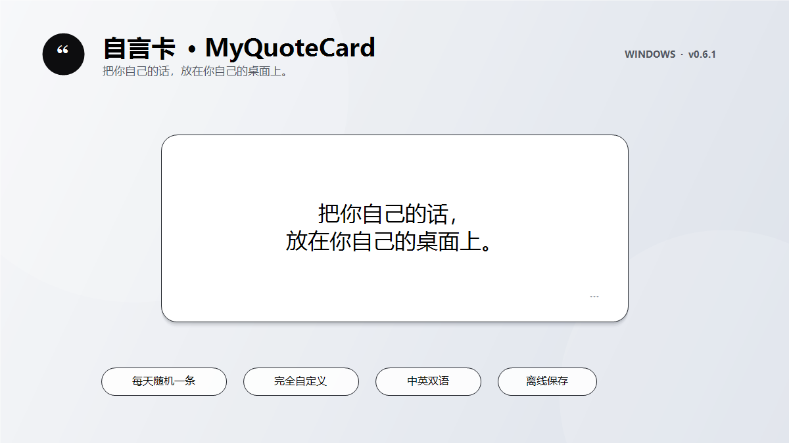

# 自言卡 · MyQuoteCard

> 把你自己的话，放在你自己的桌面上。



[前往 Releases 下载最新版](../../releases/latest)

自言卡是一张轻量的 Windows 桌面文字卡片。内容完全由你决定：写下句子、提醒、摘录或一小段话，软件每天随机显示一条。

默认外观是白底黑字，不显示日期或星期。你也可以自由调整颜色、字体、背景图片、透明背景和卡片大小。

## 主要功能

- 每天从你的内容库中随机选择一条内容
- 双击文字即可编辑内容库
- 拖动卡片改变位置，拖动边缘或四角调整大小
- 文字自动适应卡片，也可手动调整字号
- 自定义背景颜色、文字颜色、字体和背景图片
- 可选透明背景、置顶或置底
- 中文 / English 界面切换
- 可选随 Windows 开机启动
- 找不到卡片时，按 `Ctrl + Alt + Q`、双击托盘图标或再次打开软件
- 数据只保存在本机，不联网、不收集数据

## 快速开始

1. 在 [Releases](../../releases/latest) 下载 `MyQuoteCard-0.6.1.exe`。
2. 把文件放到一个固定位置，例如“文档”或自己建立的软件文件夹。
3. 双击运行。第一次启动时可以选择是否开机自启动。
4. 双击卡片文字编辑内容；右键卡片打开全部设置。

软件目前没有代码签名。Windows 可能显示安全提醒，请确认文件来自本仓库并核对 Release 中提供的 SHA-256 校验值。

## 内容和设置保存在哪里

所有内容与设置保存在：

```text
%LOCALAPPDATA%\MyQuoteCard
```

其中 `quotes.txt` 是你的内容库。卸载时直接退出软件并删除 EXE；如需同时删除个人内容，再删除上面的文件夹。

## 从源码构建

项目使用 Windows 自带的 .NET Framework 编译器，不依赖第三方程序包。

```text
双击 build.bat
```

构建完成后，程序位于 `dist\MyQuoteCard.exe`。也可以运行：

```text
MyQuoteCard.exe --self-test
```

进程返回值为 `0` 表示内置检查通过。

## 反馈

欢迎在 [Issues](../../issues) 报告问题或提出建议。请勿在截图或日志中公开自己的私人内容库。

本项目采用 [MIT License](LICENSE)。

---

## English

MyQuoteCard is a lightweight Windows desktop card for words chosen entirely by you. Add quotes, reminders, excerpts, or short passages; the app displays one random entry each day.

The default appearance is black text on a white card, with no date or weekday. Colors, fonts, background images, transparency, size, and window layer are customizable.

### Highlights

- A stable random entry for each day
- Double-click the text to edit your library
- Drag to move; drag an edge or corner to resize
- Automatic text fitting and manual size controls
- Custom colors, fonts, and background images
- Optional transparency, top or bottom window layer
- Chinese / English interface
- Optional launch with Windows
- Press `Ctrl + Alt + Q`, double-click the tray icon, or launch the app again to find a lost card
- Local-only storage with no network access or telemetry

Download the latest EXE from [Releases](../../releases/latest). See [PRIVACY.md](PRIVACY.md) for the privacy statement.

